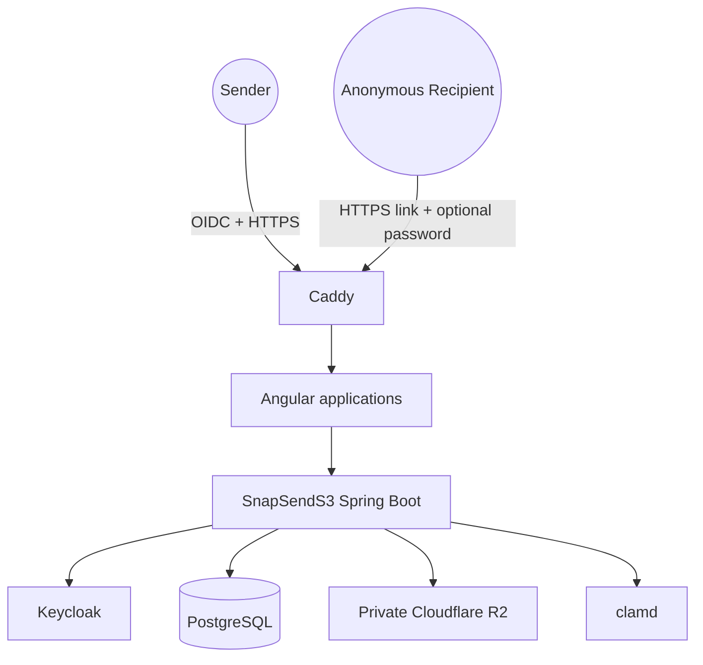
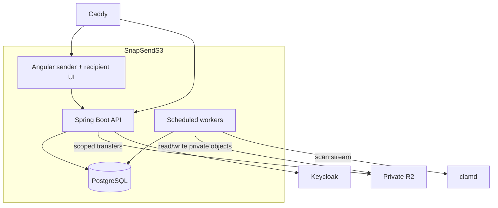
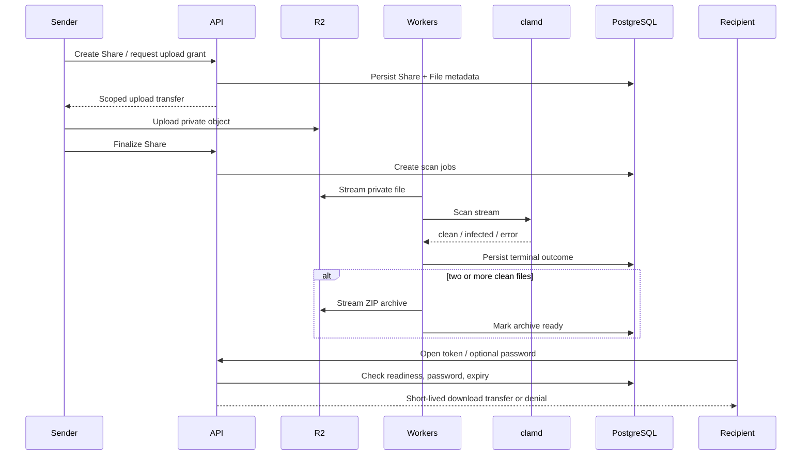
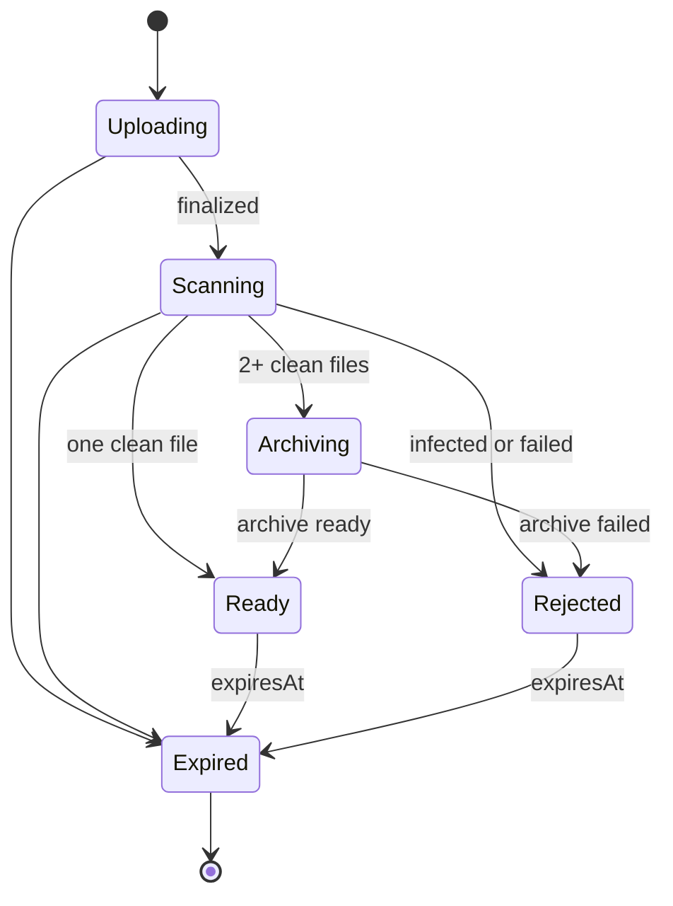

# HLD · SnapSendS3 External Document Sharing

**Slug:** `external-document-sharing`  
**Version:** 1.0  
**Status:** Approved for conditional local-demo planning  
**Date:** 2026-10-22  
**Author / approver:** Sebastian Szekely

## 1. Executive Summary

### 1.1 Purpose

SnapSendS3 lets a Keycloak-authenticated Sender share one or more operational files with an anonymous external Recipient through an HTTPS link that expires after six hours. The design prevents download unless every source file is clean-scanned. [OBS: PRD R-001–R-007]

### 1.2 Objectives & Business Value

- Replace illustrative email/personal-transfer workarounds with a controlled local-demo flow. [OBS: PRD §1]
- Keep R2 objects private while allowing temporary recipient delivery. [OBS: NFR-002]
- Make unsafe, pending, or failed scans unavailable. [OBS: R-003, NFR-003]
- Package two or more files as one ZIP. [OBS: R-004]

### 1.3 Scope & Non-goals

In scope: authenticated creation, private upload, scan-gated archive/download, optional password, six-hour expiry, cleanup, safe audit outcomes, and configured usage guardrails. [OBS: PRD R-001–R-010]

Out of scope: recipient accounts or identity checks, revocation, download limits, billing, notifications, branded portal, production deployment, and production compliance certification. [OBS: PRD §9]

### 1.4 Key Architecture Decisions

- Use a Spring Boot modular monolith with explicit internal modules — [ADR-001](../decisions/external-document-sharing-adr-001-modular-monolith.md).
- Use backend-authorized, object-specific short-lived R2 transfers — [ADR-002](../decisions/external-document-sharing-adr-002-direct-scoped-r2-transfers.md).
- Persist lifecycle work as PostgreSQL job records and run scheduled workers — [ADR-003](../decisions/external-document-sharing-adr-003-postgresql-backed-workers.md).
- Use `clamd` streaming and fail closed — [ADR-004](../decisions/external-document-sharing-adr-004-clamd-scan-gate.md).
- Stream multi-file ZIP output to R2 — [ADR-005](../decisions/external-document-sharing-adr-005-streaming-zip-to-r2.md).
- Enforce application expiry with R2 lifecycle as defense in depth — [ADR-006](../decisions/external-document-sharing-adr-006-dual-expiry-cleanup.md).

### 1.5 System Identifier

The canonical system and domain name is **SnapSendS3 External Document Sharing**; its warehouse slug is `external-document-sharing`. [OBS: PRD front matter]

## 2. System Overview

### 2.1 Business Context and Responsibilities

SnapSendS3 owns Share lifecycle, password verification, expiry enforcement, download authorization, lifecycle metadata, and worker orchestration. It does not own sender identities, object bytes, malware detection, TLS edge routing, or recipient identity. [OBS: boundary map §2]

### 2.2 Stakeholders

| Stakeholder | Interaction |
|---|---|
| Sender | Authenticates with Keycloak, creates and finalizes a Share, sees status. [OBS: R-001, R-010] |
| Recipient | Opens a public HTTPS link, optionally supplies a password, obtains a short-lived download grant. [OBS: R-005, R-006] |
| Sebastian Szekely | Product, architecture, engineering, and demo-operator authority. [OBS: PRD §16] |

### 2.3 Requirements

The feature maps every functional requirement R-001–R-010 and every NFR-001–NFR-009 from the PRD. The minimum demo limits are 100 MB per file and 500 MB per Share, pending capacity proof. [OBS: PRD §§6–8]

### 2.4 System Boundary and External Interactions

External dependencies are Keycloak (sender identity), Cloudflare R2 (private bytes), ClamAV (verdict), Caddy (HTTPS ingress), and PostgreSQL (application persistence). The R2, Keycloak, ClamAV, and Caddy contracts remain conditional until their tracked blockers are evidenced. [OBS: boundary map §3]

### 2.5 Context Diagram

## 3. Architecture Principles

- **Private-by-default bytes:** R2 objects remain private; the API decides when to issue a short-lived transfer. [OBS: NFR-002; ADR-002]
- **Fail closed:** an unavailable, pending, infected, or failed scan never grants download. [OBS: R-003; ADR-004]
- **Explicit module ownership:** no worker authorizes recipients and no API owns scanner verdicts. [OBS: design sketch §2]
- **Durable milestones, not infrastructure sprawl:** PostgreSQL job records drive scan, archive, and cleanup work; no broker is introduced for the local demo. [OBS: ADR-003]
- **No invented production posture:** SLAs, regions, production topology, and compliance duties remain open. [OBS: PRD §10]

## 4. Technology Stack

| Area | Choice | Status |
|---|---|---|
| Frontend | Angular and TypeScript | Committed [OBS: PRD §8] |
| Backend | Java 21 and Spring Boot | Committed [OBS: PRD §8] |
| Database | PostgreSQL | Committed [OBS: PRD §8] |
| Identity | Keycloak OIDC/JWT, proposed `roles:dava.sender` | Conditional [ASM: BLK-002] |
| Object storage | Private Cloudflare R2 S3-compatible bucket | Conditional contract [ASM: BLK-001] |
| Malware scanning | `clamd` streaming | Conditional contract [ASM: BLK-003] |
| Archive | Java ZIP streaming | Conditional capacity [ASM: BLK-004] |
| Edge | Caddy HTTPS reverse proxy | Local-demo only [ASM: BLK-004] |
| Migration, CI/CD, production hosting | Not selected | TBD [OBS: boundary map §4] |

Configuration is externalized and secrets never enter source, audit, or logs. [OBS: NFR-008]

## 5. High-Level Architecture

### 5.1 Architecture Approach

The system is a modular monolith: one deployable Spring Boot application with clear sender, public-access, lifecycle, worker, persistence, and R2 adapter boundaries. It minimizes demo operational overhead while retaining seams for later extraction. [OBS: DEC-008; ADR-001]

### 5.2 Container Diagram

### 5.3 Container Responsibilities

| Container | Responsibility | Explicitly does not do |
|---|---|---|
| Angular UI | Sender and recipient interactions, accessible status display. | Does not decide authorization or handle R2 credentials. |
| Spring Boot API | Authenticates sender, owns Share policy/lifecycle, issues scoped grants. | Does not proxy object bytes or scan files. |
| Workers | Scan, archive, expiry cleanup from durable job state. | Do not grant downloads or alter expiry. |
| PostgreSQL | Lifecycle, audit outcome, password hash, job metadata. | Does not store original/archive bytes. |

## 6. Component Architecture

| Module | Owns | Depends on |
|---|---|---|
| Sender API | Share creation/finalization and upload authorization (R-001, R-002). | Keycloak, lifecycle, R2 adapter. |
| Public Share API | Token/password/expiry checks and download grant decision (R-005, R-006). | Lifecycle, R2 adapter. |
| Lifecycle | Valid Share/File/Archive transitions and readiness (R-003, R-007, R-010). | PostgreSQL. |
| Scan worker | Scan job attempts and clean/infected/failed outcome. | Lifecycle, clamd, R2. |
| Archive worker | ZIP job and archive outcome for clean multi-file Shares. | Lifecycle, R2. |
| Cleanup worker | Idempotent object/metadata cleanup attempts. | Lifecycle, R2. |
| Usage guardrail | Warn/reject decision from configured budget. | Configuration and usage snapshot. |

Cross-cutting controls are server-side size validation, opaque tokens, password hashing, idempotent job handling, secret-safe structured logs, and controlled-clock expiry tests. [OBS: PRD R-002, R-006–R-009; NFR-004, NFR-008]

## 7. Runtime View

### 7.1 Create, Scan, Archive, and Download

### 7.2 Failure Rules

Scan timeout or transient error retries at most three times within the proposed 60-second scan timeout; exhaustion becomes `FAILED` and produces no download grant. Infected files become `INFECTED`. [OBS: PRD Q-003; ASM: BLK-003]

At `expiresAt`, the API denies access regardless of cleanup status. Cleanup records retryable outcomes; R2 lifecycle provides a second deletion mechanism. [OBS: R-007; ADR-006]

## 8. Data & Domain Model

### 8.1 Bounded Context

SnapSendS3 contains one bounded context, External Document Sharing. It owns Share, Share File, Archive, Download Attempt, and job records. Keycloak, R2, ClamAV, and Caddy are external systems. [OBS: locked domain model; boundary map]

### 8.2 Persistence

| Record | Important data | Owner |
|---|---|---|
| Share | opaque token, sender subject, expiry, password hash, status | Lifecycle |
| ShareFile | logical metadata, object key, scan state | Lifecycle |
| Archive | private object key, status, size | Archive worker |
| Job | type, binding, attempt count, terminal state | Worker orchestration |
| DownloadAttempt | timestamp and non-secret outcome | Public Share API |

Passwords, R2 credentials, transfer URLs, and content are excluded from audit records. [OBS: NFR-008]

### 8.3 Access Patterns

Primary lookups are opaque share token, Share status/expiry, ready archive, and pending job state. Index design is implementation detail; it must support expiry and worker polling without scanning all Shares. [INF: R-007, DEC-010]

### 8.4 State Transitions

## 9. Quality Attributes

- **Security:** HTTPS via Caddy, Keycloak sender authentication, optional password hash, private R2, opaque token, and grant TTL enforce NFR-001/002/008. R2 and Keycloak proof is still required. [OBS/ASM: NFR-001/002/008; BLK-001/002]
- **Resilience:** durable jobs, three retry limit, 60-second scan timeout, terminal scan states, and idempotent cleanup meet the intended NFR-003/004/007 behavior. [OBS/ASM: PRD Q-003]
- **Capacity:** server-side 100 MB/file and 500 MB/Share enforcement applies to upload and ZIP creation; no throughput SLA is asserted. [OBS/ASM: NFR-005; Q-001]
- **Accessibility:** keyboard-capable sender/recipient flows and automated WCAG-AA-oriented checks are mandatory. [OBS: NFR-006]
- **Observability:** structured state, worker, cleanup, and safe access outcomes are logged; exact dashboards/SLOs are deferred. [OBS: NFR-007/008]

## 10. Operational Concerns

The approved topology is local demo only: Caddy terminates HTTPS and routes to Angular/Spring Boot; PostgreSQL, Keycloak, clamd, and R2 integration support the application. Production regions, HA, backups, deployment mechanism, SLA, and on-call policy are not designed. [OBS: PRD §8; ASM: production topology]

Configuration includes object bucket/endpoint, transfer TTL, 100 MB/500 MB limits, scan timeout/retries, expiry duration, usage budgets, Caddy body/time limits, and OIDC values. Secrets are supplied outside source control. [INF: PRD constraints]

Operators respond to `FAILED` scans by keeping the Share unavailable; cleanup failures are retried; quota rejection blocks new upload authorization. [OBS: PRD R-003/R-007/R-008]

## 11. API & Integration Contracts

| Surface | Responsibility | Error / idempotency expectation |
|---|---|---|
| Authenticated Share API | Create Share, authorize uploads, finalize, query sender status. | Reject unauthenticated/unauthorized/over-limit requests; finalization is idempotent. |
| Public Share API | Resolve opaque token, verify optional password, issue download grant. | Never reveal permanent object location; unavailable/expired/password-failed responses log a safe outcome. |
| R2 adapter | Create scoped upload/download transfer and access private objects for workers. | Contract is provisional pending BLK-001. |
| Keycloak adapter | Validate issuer/audience and sender role. | Contract is provisional pending BLK-002. |
| ClamAV adapter | Stream bytes and return bounded verdict. | Contract is provisional pending BLK-003. |

OpenAPI, exact payload schemas, status codes, and transfer TTL are Govern implementation outputs. [ASM: no API contract supplied]

## 12. Risks, Trade-offs, and Open Questions

### 12.1 Risks

The seven open risks in the [risk register](../explore-external-document-sharing/risks.md) remain open. The four direct implementation constraints are BLK-001 R2 scoped transfers, BLK-002 Keycloak claims, BLK-003 clamd behavior, and BLK-004 Caddy/capacity validation. [OBS: blocker register]

### 12.2 Trade-offs

- Direct R2 transfers reduce API byte handling but require a proven scoped-grant contract. [ADR-002]
- PostgreSQL jobs avoid a broker but require reliable polling and idempotency. [ADR-003]
- Streaming ZIP avoids local disk use but requires capacity validation. [ADR-005]
- Anonymous access lowers recipient friction but intentionally excludes identity controls, download limits, and revocation. [OBS: PRD §8/§9]

### 12.3 Open Questions

| Question | Owner | Target |
|---|---|---|
| Validate R2 scoped transfers. | Sebastian Szekely | Before storage implementation |
| Validate `roles:dava.sender` claim mapping. | Sebastian Szekely | Before authentication integration |
| Validate clamd timeout/retry terminal behavior. | Sebastian Szekely | Before scan worker implementation |
| Validate size limits and Caddy configuration. | Sebastian Szekely | Before demo implementation commitment |
| Set absolute storage/operation budgets. | Sebastian Szekely | Before demo configuration |
| Resolve compliance, carrier fit, production topology and SLA. | Sebastian Szekely | Before production promotion |

### 12.4 Assumptions

The direct R2, `clamd`, streamed ZIP, and R2 lifecycle integrations are retained as test-gated assumptions; they are not production guarantees. [ASM: design sketch §10]

## 13. Future Enhancements

| Enhancement | Trigger | Accommodation | Impact |
|---|---|---|---|
| Recipient identity, revocation, download limits | Fraud/compliance/business need | Public Share API remains policy boundary. | Medium |
| Notifications and branded recipient portal | Product validation | Angular public experience can gain routes without changing storage boundary. | Medium |
| Production topology, observability, and compliance controls | Production promotion | Modular monolith separates adapters and workers for future deployment choices. | High |
| Worker extraction or broker | Durable workload outgrows PostgreSQL jobs | Module boundaries and job contracts support extraction. | High |

## Document History

| Version | Date | Author | Change |
|---|---|---|---|
| 1.0 | 2026-10-22 | Sebastian Szekely | Full HLD promoted from approved Fast Lane design sketch under autonomous Explore completion. |
