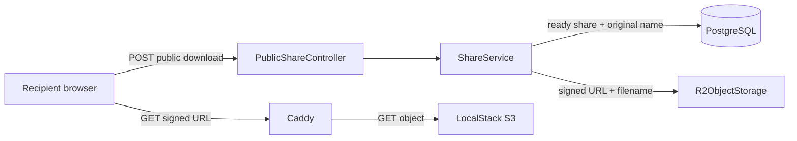

# SNS003 — Fix Invalid Single-File Download

## Overview

One-file shares keep the uploaded source object as their ready download object. The recipient response can therefore contain a PNG, PDF, or other source bytes, while the old delivery metadata labelled it as `snapsends3-share.zip`. Windows correctly rejects that file as an invalid archive. This task makes each delivery name match the ready object: the original upload name for one file and `snapsends3-share.zip` for multiple files.

The scope is local Compose usage through `https://localhost:8443`. It retains private, short-lived object storage URLs, scan gating, password checks, and expiry enforcement.

## References

- [SNS001 epic](../../../explore/epics/SNS001-snapsends3-secure-sharing.md)
- [ADR-002: direct scoped R2 transfers](../../../explore/decisions/external-document-sharing-adr-002-direct-scoped-r2-transfers.md)
- [ADR-005: multi-file ZIP archives](../../../explore/decisions/external-document-sharing-adr-005-streaming-zip-to-r2.md)
- [ADR-006: expiry enforcement](../../../explore/decisions/external-document-sharing-adr-006-dual-expiry-cleanup.md)
- [Local repository guide](../../../docs/repositories.md)

## Technical Decisions

1. One-file shares remain raw source objects. `ShareCompletionService` already marks that object ready; do not archive it.
2. `ShareService.createPublicDownload` chooses the delivery filename after authorization:
   - exactly one `ShareFile`: `ShareFile.originalName`
   - otherwise: `snapsends3-share.zip`
3. `ObjectStorage.createDownloadUrl` accepts that filename. `R2ObjectStorage` signs `response-content-disposition` as an attachment, after replacing CR, LF, and quotes in the name.
4. Caddy maps the signed disposition query value to its response `Content-Disposition` header for `/snapsends3/*`, preserving behavior when LocalStack does not honor the S3 response override.
5. The Angular recipient view remains a normal anchor to the short-lived URL. The attachment header causes the browser to save the file with the correct name.

## Architecture

## Implementation Plan

### 1. Add regression coverage first

- Extend `apps/api/src/test/java/com/snapsends3/service/ShareServiceTest.java` to verify that a one-file ready share invokes `ObjectStorage.createDownloadUrl` with its original name.
- Add the corresponding multi-file assertion for `snapsends3-share.zip`.
- Add an adapter-level test, where practical, for filename sanitization and signed attachment disposition.

### 2. Apply delivery metadata changes

- Update `apps/api/src/main/java/com/snapsends3/storage/ObjectStorage.java` only if its download URL contract does not already carry the delivery name.
- Update `apps/api/src/main/java/com/snapsends3/service/ShareService.java` to select the name based on file count after ready, expiry, and password checks.
- Update `apps/api/src/main/java/com/snapsends3/storage/R2ObjectStorage.java` to sign attachment disposition safely.
- Update `ops/Caddyfile` only if the LocalStack proxy does not already emit the signed response disposition.

### 3. Verify the full local flow

- Rebuild the affected services with `docker compose up --build -d`.
- Create fresh one-file and multi-file shares at `https://localhost:8443`.
- Fetch each issued URL and verify attachment header, filename, file magic bytes, and ZIP integrity.

## Test Inventory

| Level | Scenario | Expected result |
|---|---|---|
| Unit | Ready one-file share | Original filename is supplied to object storage. |
| Unit | Ready multi-file share | `snapsends3-share.zip` is supplied to object storage. |
| Unit | Unsafe filename | CR, LF, and quotes cannot inject headers. |
| Service | Unready, expired, and password-protected shares | Existing 409, 410, and 401 results remain. |
| Integration | One-file local browser-visible URL | Attachment name and bytes match the source object. |
| Integration | Multi-file local browser-visible URL | Valid ZIP opens and contains all source files. |

## Acceptance Criteria

- A ready one-file share saves under the uploaded filename and has unchanged source bytes.
- A ready multi-file share saves as a valid `snapsends3-share.zip` archive containing all uploaded files.
- Browser-visible local download responses use attachment disposition.
- Existing scan, password, and expiry controls remain unchanged.

## Risks and Mitigations

| Risk | Mitigation |
|---|---|
| Header injection via filename | Sanitize CR, LF, and quotes before signing. |
| LocalStack ignores the signed override | Verify Caddy injects the signed disposition. |
| Authorization regression | Preserve checks before filename selection and run service tests. |

## Non-Goals

- Public DNS or production deployment.
- Replacing LocalStack with Cloudflare R2.
- Changing the multi-file archive format.

## Completion Evidence

- API test suite passes.
- Fresh one-file and multi-file downloads pass content and archive validation through `https://localhost:8443`.
