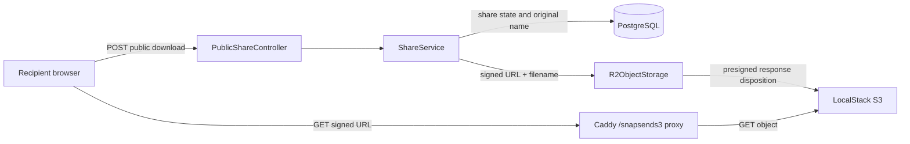

# Architectural Context

## Component Diagram

## Components Involved

- **ShareService**: chooses the recipient delivery name only after all download authorization checks pass.
- **R2ObjectStorage**: signs the object request with an attachment disposition.
- **Caddy**: returns the signed disposition to browsers in the LocalStack path.
- **ShareCompletionService**: establishes whether the ready object is a source file or a ZIP archive.

## Integration Points

- **PostgreSQL**: `ShareFile.originalName` is the one-file delivery name.
- **S3-compatible object storage**: stores raw uploads or multi-file archives and accepts signed GET query parameters.
- **Browser**: consumes the response header to save a file under its intended name.

## Test Boundaries

- **Unit Tests**: `ShareService` mocks `ObjectStorage` and verifies one-file versus multi-file name selection.
- **Integration Tests**: API, Caddy, and LocalStack prove the response header and bytes at the browser-visible URL.
- **E2E Tests**: sender upload through recipient download verifies the complete flow.

## Downstream Impacts

- Sender and recipient authorization paths remain unchanged.
- Existing multi-file ZIP delivery remains unchanged.
