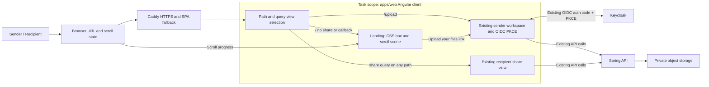

# SNS004 — Modern Scroll-Driven Landing Experience

## Overview

The current SnapSendS3 web client opens directly into a functional sender workspace, but it lacks the polished first impression requested for the product. This task adds a dedicated scroll-driven landing experience with a refined white-and-blue box reveal and a clear route to the existing sender/sign-in workspace. The new page must preserve the existing sign-in, upload, and recipient share behavior.

The web client is a standalone Angular 19 application. It currently has no Angular Router and uses a single root component for the sender and recipient experiences. Caddy already falls back to `index.html` for application paths.

## Task Definition Reference

- [Task requirements](task.md)
- Stakeholders: senders, recipients, product/design owner, web engineering.
- Goals: focused modern landing page, responsive scroll reveal, easily found CTA, preserved authentication and recipient links.
- Constraints: existing OIDC behavior must remain unchanged; no new animation/runtime dependency without need; support reduced motion and keyboard navigation.
- Non-goals: backend/storage changes, a new login flow, sender workspace/recipient redesign, Apple product/brand imitation, unrelated functionality.

## References and Related Work

- [Approved external document sharing PRD](../../../explore/prds/external-document-sharing-prd.md), especially NFR-006 accessible flows.
- [External document sharing HLD](../../../explore/hlds/external-document-sharing-hld.md), Angular sender/recipient experience and future-route context.
- [ADR-001: modular monolith](../../../explore/decisions/external-document-sharing-adr-001-modular-monolith.md).
- [ADR-002: direct scoped R2 transfers](../../../explore/decisions/external-document-sharing-adr-002-direct-scoped-r2-transfers.md); upload/download boundary remains unchanged.
- [Repository and deployment notes](../../../docs/repositories.md).
- [Current Angular root component](../../../apps/web/src/main.ts), [styles](../../../apps/web/src/styles.css), [package manifest](../../../apps/web/package.json), [Angular config](../../../apps/web/angular.json), and [Caddy SPA fallback](../../../ops/Caddyfile).
- [Keycloak realm client config](../../../ops/keycloak/snapsends3-realm.json) permits origin-relative redirect paths with a wildcard.
- Related capability context: [SNS001 plan](../../04-implementing/SNS001-epic-formation-for-snapsends3-external-document-sh/plan.md). [SNS003](../../06-completed/SNS003-fix-invalid-single-file-download/summary.md) is complete and has no direct implementation dependency.

## Technical Decisions

### 1. Preserve existing paths and query behavior

Use path/query-based view selection in the existing root component without adding Angular Router:

- `/` with no `share` query or OIDC callback renders the new landing page.
- `/upload` renders the existing sender workspace and sign-in action.
- A `share` query parameter takes precedence on either path, preserving legacy `/?share=...` URLs and allowing new `/upload?share=...` links.
- OIDC callback values continue through existing `finishSignIn()` logic. Sign-in initiated from `/upload` keeps the current pathname-based redirect URI and returns to `/upload`.
- The “Upload your files” control is a real link to `/upload`.

The separate route is necessary because there is no existing standalone login page: the existing sign-in action lives in the sender workspace. Direct visits to `/upload` work through Caddy's existing SPA fallback, and the checked-in Keycloak client configuration allows origin-relative redirect paths with a wildcard. Do not alter OIDC behavior.

### 2. Tie the visual reveal to scroll

Use a sticky scene inside a longer landing page. Build the box faces from semantic-safe decorative HTML/CSS elements, with subtle gradients, perspective, highlights, and restrained soft-white/warm-gold interior light. Compute normalized scene progress from browser scroll position, clamp it to `[0, 1]`, and schedule at most one visual update per animation frame. Apply progress through CSS custom properties to the lid rotation, light intensity, and subtle elevation. Do not route every frame through Angular template state or change detection.

Keep the CTA in normal page flow after the scene so it remains reachable independently of animation timing. On `prefers-reduced-motion: reduce`, skip scroll-driven transforms and present a static or brief fade state. Ensure the CTA remains usable if the scroll enhancement does not initialize.

### 3. Keep dependencies and business logic unchanged

Use existing Angular, browser scroll APIs, CSS transforms, and `matchMedia`; add no runtime dependencies. Do not change API, persistence, private storage, share lifecycle, OIDC PKCE, token storage, or upload behavior. Scope the new dark palette and visual rules so the sender and recipient screens retain their current theme.

## Architecture

No API, database, or storage changes are required. Caddy's configured `try_files {path} /index.html` fallback already supports `/upload`.

## Component Changes

### `apps/web/src/main.ts`

- Add path/query-aware rendering: landing, sender workspace, recipient view.
- Give `share` precedence so existing and new recipient URLs resolve on either path.
- Add the landing content and `/upload` CTA.
- Connect scroll progress to a CSS property using a passive listener and `requestAnimationFrame`; ensure listener and media-query subscriptions are cleaned up with component lifecycle.
- Preserve existing `signIn()`, `finishSignIn()`, recipient loading, sender upload, and share URL handling.

### `apps/web/src/styles.css`

- Add isolated dark landing styles, responsive box faces, perspective, warm interior glow, scroll reveal states, CTA styles, and clear hover/active/focus states.
- Respect reduced-motion preference and preserve the existing sender/recipient appearance.

### `apps/web/src/index.html`

- Update title/description only if needed to identify the landing experience clearly.

## Test Inventory

### Build and route smoke checks

| Scenario | Expected result |
|---|---|
| `GET /` | App shell loads and landing page is rendered. |
| `GET /upload` | Caddy SPA fallback serves app shell and existing sender/sign-in workspace renders. |
| `GET /?share=<token>` | Existing recipient view renders; landing does not override the share route. |
| `GET /upload?share=<token>` | Existing recipient view renders on the upload path. |
| OIDC callback at `/upload?code=...&state=...` | Existing PKCE callback completes and user returns to sender workspace; configured Keycloak redirect wildcard permits the path. |

### Browser validation

- Activate CTA with pointer and keyboard; confirm route is `/upload`.
- Scroll through start, midpoint, and end on mobile and desktop; verify lid and glow correspond to scroll position.
- Enable reduced motion; verify no scroll-driven transform and CTA remains immediately usable.
- Validate touch, wheel, Page Down, short viewport, zoom, keyboard focus, screen-reader semantics, contrast, and absence of horizontal overflow.
- Verify old root share links, newly generated `/upload?share=...` links, sender sign-in, and upload behavior.
- Confirm artwork is decorative to assistive technology, primary heading and CTA are meaningful, and important information is not encoded only in color or animation.

### Harness limitation

`apps/web/package.json` declares `npm test`, but `apps/web/angular.json` has no test target and no browser-test setup is present. Do not claim automated unit/E2E coverage until a harness exists. Run `npm run build` and complete the route, visual, accessibility, and authentication walkthrough. If automated browser coverage is required, resolve test-harness scope before adding packages.

## Acceptance Criteria

1. `/` without recipient/auth callback parameters displays a dedicated charcoal-to-black landing page with centered white-and-blue box.
2. Scrolling progressively opens the box and reveals restrained white and warm-gold light, mapped to scroll position and usable at mobile and desktop widths.
3. A prominent “Upload your files” link is available after the scene and navigates to `/upload`.
4. Existing sign-in, PKCE callback, and sender upload workspace remain operational without a new auth flow.
5. Existing `/?share=...` links and new `/upload?share=...` links both render the current recipient experience.
6. If scroll enhancement fails or reduced motion is preferred, the page remains usable and CTA remains reachable; reduced-motion users see a static or fade-based presentation.
7. Keyboard focus is visible; control semantics, contrast, and decorative artwork treatment are accessible; hover and pressed states give clear feedback.
8. Layout works at mobile, tablet, and desktop sizes without horizontal overflow or inaccessible CTA.
9. Existing upload, share, recipient API, and download behavior is unchanged.

## Risks and Dependencies

| Risk | Likelihood / Impact | Mitigation |
|---|---|---|
| Root view change breaks old recipient links | Medium / High | Give `share` query precedence independent of path; test existing root and new upload-path share URLs. |
| Scroll effect stutters on mobile | Medium / Medium | Limit to one rAF update; avoid Angular change detection; test touch and varied viewport sizes. |
| CTA is hidden or awkward on short/zoomed viewports | Medium / Medium | Keep CTA in normal document flow and independent of animation completion. |
| Automated tests cannot run via current `npm test` script | High / Medium | Production build and explicit browser walkthrough; scope a harness separately if needed. |

Blocking dependencies: none identified. No backend, storage, or data-model dependencies.

## Implementation Strategy

### Phase 1: Route and layout foundation

1. Add route/query view selection for `/`, `/upload`, and `share` precedence.
2. Add landing structure and scoped charcoal styling while preserving existing sender/recipient styles.
3. Verify direct `/upload`, old root share links, new upload-path share links, and OIDC callback handling.

### Phase 2: Core box reveal and CTA

1. Build CSS box faces, perspective, shine, and interior light.
2. Implement clamped scroll progress with passive listener and rAF updates.
3. Add prominent `/upload` CTA and clear hover/active/focus feedback.
4. Add reduced-motion fallback and accessible semantics.

### Phase 3: Integration and polish

1. Validate responsive layouts, short viewports, zoom, touch, keyboard, and reduced motion.
2. Recheck OIDC, existing upload workspace, and legacy/new recipient URL flows.
3. Run production build and record manual browser/accessibility verification; note current missing test target.

## Scope Tags

- Complexity: moderate
- Component: app
- Type: enhancement
- Priority: medium (no urgency supplied)
- Risk: medium

## Open Questions

- There is no separate login page in the existing app; this plan treats `/upload`, which contains the existing sender sign-in action, as the intended CTA destination.
- The checked-in Keycloak realm configuration allows origin-relative callback paths via a wildcard; separately managed deployments should retain equivalent redirect coverage.
