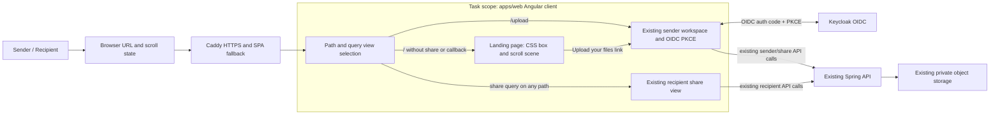

# Architectural Context

## Component Diagram

## Components Involved

- **`apps/web/src/main.ts`**: Existing standalone Angular root; route/query dispatch and landing animation lifecycle will be added here while retaining sender, recipient, and authentication behavior.
- **`apps/web/src/styles.css`**: Shared stylesheet; adds isolated landing styles while preserving sender/recipient styling.
- **`ops/Caddyfile`**: Existing SPA fallback supports `/upload`; no change expected.
- **Keycloak / API / object storage**: Existing integration targets, not modified by this task.

## Integration Points

- **Browser URL**: Path selects landing (`/`) or sender (`/upload`); `share` query selects recipient on either path. Existing OIDC callback query continues to run through `finishSignIn()`.
- **Caddy**: `try_files {path} /index.html` resolves deep links to Angular app shell.
- **Keycloak OIDC**: Existing sender redirect and PKCE callback; remain unchanged.
- **Spring API and private storage**: Existing sender upload and recipient flows remain unchanged.
- **Scroll state**: Browser scroll progress updates presentation-only CSS variables; no server or persisted-state integration.

## Test Boundaries

- **Unit/component tests**: Test route-state selection, share-query precedence, progress clamping, and reduced-motion behavior if a compatible test harness is available. No API/storage mocks are needed for the new visual surface.
- **Integration tests**: Use real Angular shell and Caddy fallback to verify `/`, `/upload`, and recipient deep links. Verify existing authentication and share paths continue to operate against configured services.
- **E2E tests**: Browser walkthrough for pointer/keyboard CTA, scroll reveal on mobile/desktop, reduced motion, and OIDC round-trip. Confirm real path/query values and avoid changing API contracts.

## Downstream Impacts

- Root page changes from sender workspace to landing page; direct sender entry becomes `/upload`.
- Existing root recipient URLs must continue to resolve by query precedence.
- New shares should use the sender pathname and remain valid as `/upload?share=...`.
- OIDC redirect URI remains pathname-specific; Keycloak redirect allow-list must already permit the origin/path as currently configured or deployment configuration may require an update.
